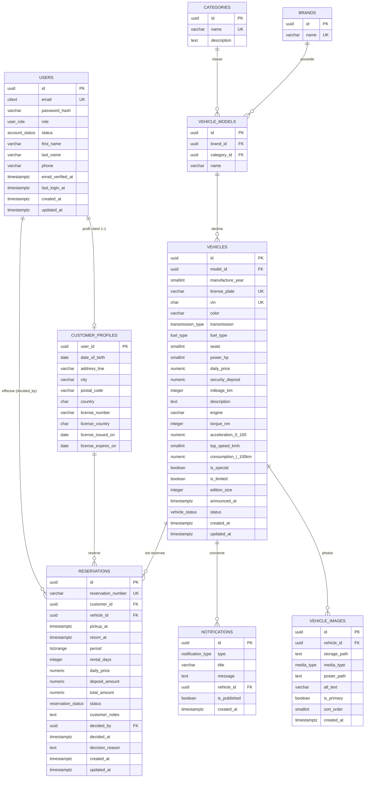
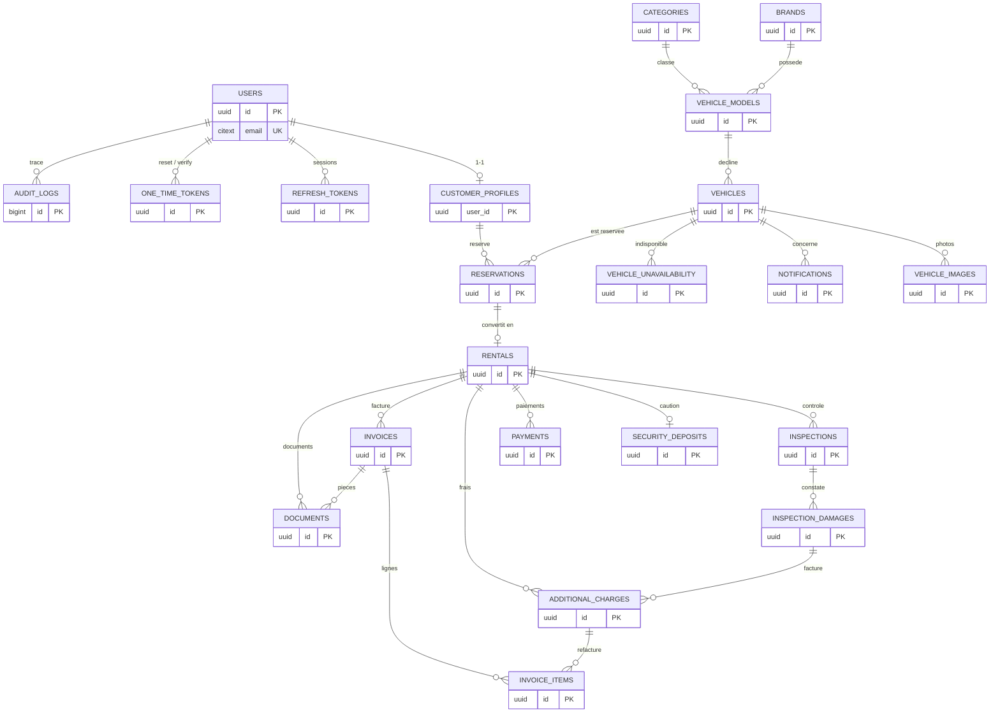
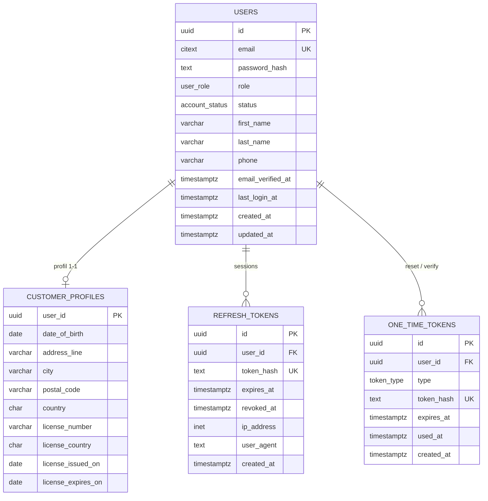
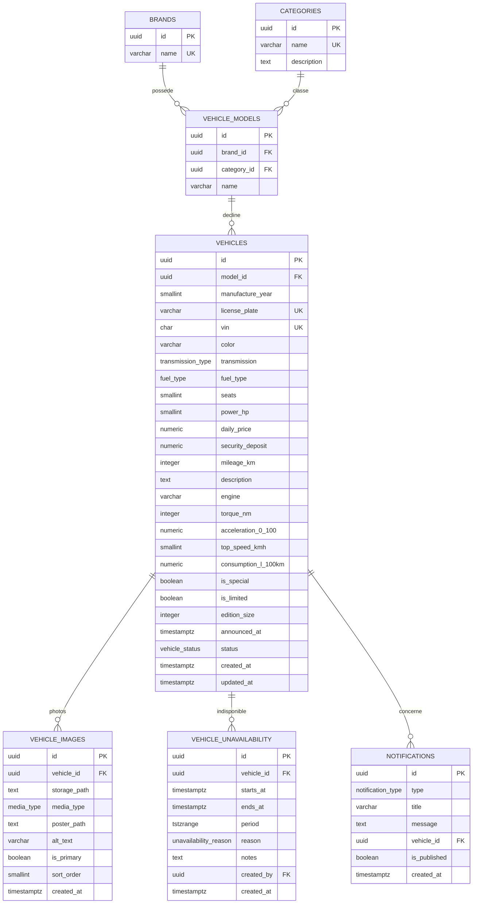
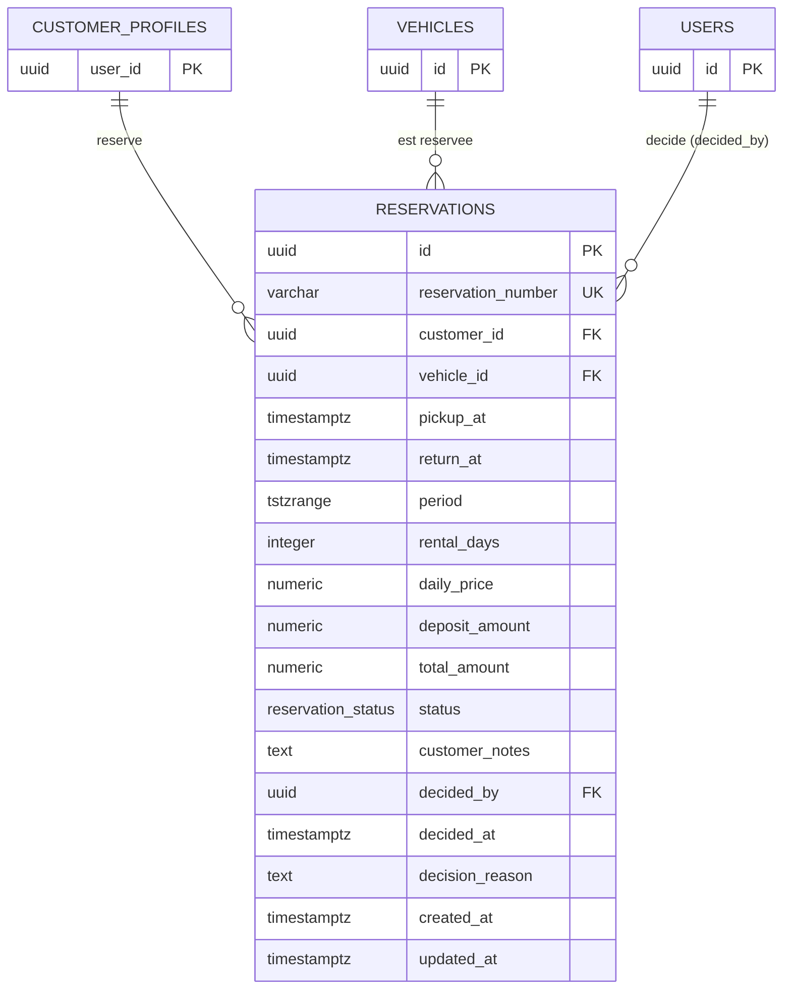
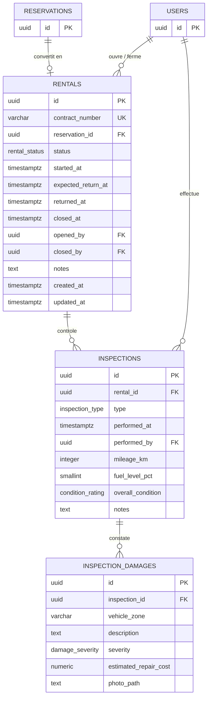
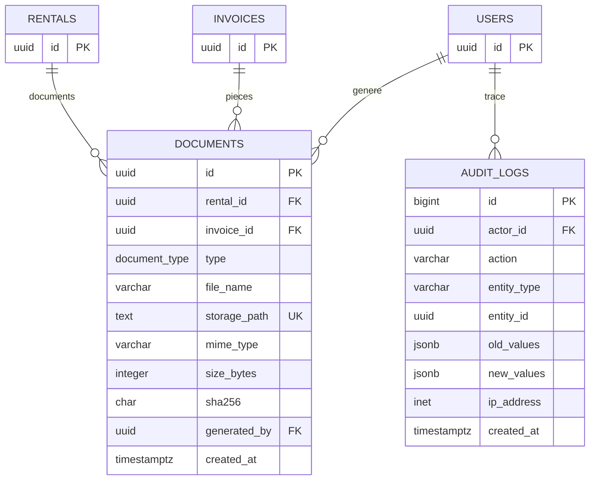

# Schémas SQL — LUXURY CARS

Document de référence des schémas de base de données du projet.

- **Source de vérité du schéma complet** : `backend/database/schema.sql`
- **Patch incrémental** : `backend/database/patches/002-editions-and-notifications.sql`
- **Migrations TypeORM** : `backend/src/database/migrations/`

Légende :

| Symbole | Signification |
| --- | --- |
| ✅ **DÉJÀ FAIT** | Table créée en base **et** utilisée par l'application (entité TypeORM ou requête applicative). |
| 🟡 **À FAIRE** | Table créée en base (schema.sql appliqué) mais **non encore exploitée** par l'application (feature prévue mais non développée). |

> État réel observé en base : les **22 tables** du schéma complet existent déjà,
> mais seule une partie est branchée dans le code.

---

## 1. Schéma de NOTRE niveau de projet (déjà fait) ✅

Périmètre réellement implémenté aujourd'hui : catalogue de voitures, comptes clients,
réservations et notifications.

**Tables de ce périmètre (✅ déjà fait)**

| Table | Entité / usage applicatif |
| --- | --- |
| `users` | `user.entity.ts` — auth, rôles |
| `customer_profiles` | `customer-profile.entity.ts` |
| `brands` | `brand.entity.ts` |
| `categories` | `category.entity.ts` |
| `vehicle_models` | `vehicle-model.entity.ts` |
| `vehicles` | `vehicle.entity.ts` |
| `vehicle_images` | gérée par les scripts (`vehicle-images.mjs`) — table vidée (stockage manuel) |
| `notifications` | `notification.entity.ts` |
| `reservations` | `reservation.entity.ts` |

---

## 2. Schéma COMPLET du projet — vue d'ensemble

Le schéma complet décrit un **système de gestion de location de voitures de luxe**
(paiements enregistrés par le personnel, tarification journalière, rôles
customer / staff / admin, devise EUR par défaut).

### 2.1 Déjà fait ✅ vs À faire 🟡

### 2.2 Détail par domaine

#### A. Authentification & utilisateurs

#### B. Catalogue de véhicules

#### C. Réservations

> Contraintes clés : `EXCLUDE USING gist` interdit le **double booking**
> (chevauchement de période pour une même voiture, statuts pending/confirmed/converted).

#### D. Locations, contrôles et retour

#### E. Argent : cautions, paiements, frais, factures

```mermaid
erDiagram
    RENTALS {
        uuid id PK
    }
    USERS {
        uuid id PK
    }
    SECURITY_DEPOSITS {
        uuid id PK
        uuid rental_id FK
        numeric amount
        deposit_status status
        numeric retained_amount
        text retention_reason
        timestamptz held_at
        timestamptz released_at
        timestamptz created_at
        timestamptz updated_at
    }
    PAYMENTS {
        uuid id PK
        uuid rental_id FK
        payment_type type
        payment_method method
        numeric amount
        char currency
        timestamptz paid_at
        varchar reference
        uuid recorded_by FK
        text notes
        timestamptz created_at
    }
    ADDITIONAL_CHARGES {
        uuid id PK
        uuid rental_id FK
        charge_type type
        varchar description
        numeric amount
        uuid inspection_damage_id FK
        uuid created_by FK
        timestamptz created_at
    }
    INVOICES {
        uuid id PK
        varchar invoice_number UK
        uuid rental_id FK
        invoice_status status
        char currency
        numeric subtotal
        numeric tax_rate
        numeric tax_amount
        numeric total_amount
        timestamptz issued_at
        uuid issued_by FK
        timestamptz created_at
        timestamptz updated_at
    }
    INVOICE_ITEMS {
        uuid id PK
        uuid invoice_id FK
        varchar description
        numeric quantity
        numeric unit_price
        numeric line_total
        uuid additional_charge_id FK
    }
    INSPECTION_DAMAGES {
        uuid id PK
    }

    RENTALS ||--o| SECURITY_DEPOSITS : "caution"
    RENTALS ||--o{ PAYMENTS : "paiements"
    RENTALS ||--o{ ADDITIONAL_CHARGES : "frais"
    INSPECTION_DAMAGES ||--o{ ADDITIONAL_CHARGES : "facture"
    RENTALS ||--o{ INVOICES : "facture"
    USERS ||--o{ PAYMENTS : "enregistre"
    USERS ||--o{ INVOICES : "emet"
    INVOICES ||--o{ INVOICE_ITEMS : "lignes"
    ADDITIONAL_CHARGES ||--o{ INVOICE_ITEMS : "refacture"
```

#### F. Documents & journal d'audit

---

## 3. Énumérations PostgreSQL

| Enum | Valeurs |
| --- | --- |
| `user_role` | customer, staff, admin |
| `account_status` | invited, active, suspended |
| `token_type` | password_reset, email_verification |
| `transmission_type` | automatic, manual, semi_automatic |
| `fuel_type` | petrol, diesel, hybrid, plug_in_hybrid, electric |
| `vehicle_status` | active, maintenance, retired |
| `media_type` | image, video |
| `unavailability_reason` | maintenance, repair, inspection, other |
| `reservation_status` | pending, confirmed, rejected, cancelled, expired, converted |
| `rental_status` | active, returned, closed |
| `inspection_type` | handover, return |
| `condition_rating` | excellent, good, fair, damaged |
| `damage_severity` | minor, moderate, major |
| `payment_type` | rental_payment, deposit_payment, deposit_refund, charge_payment, refund |
| `payment_method` | cash, card, bank_transfer |
| `deposit_status` | pending, held, released, partially_retained, retained |
| `charge_type` | late_return, fuel, mileage, damage, cleaning, other |
| `invoice_status` | draft, issued, paid, void |
| `document_type` | contract, invoice, inspection_report, other |
| `notification_type` | new_vehicle, special_edition, limited_edition, general |

---

## 4. Vues & fonctions

| Objet | Type | Rôle |
| --- | --- | --- |
| `find_available_vehicles(p_from, p_to)` | fonction SQL | véhicules réservables sur une période |
| `v_dashboard_summary` | vue | compteurs admin (véhicules, réservations, locations, clients) |
| `v_monthly_revenue` | vue | chiffre d'affaires mensuel (cautions exclues) |
| `set_updated_at()` | trigger function | met à jour `updated_at` |
| `trg_reservation_vs_unavailability()` | trigger | bloque réservation vs indisponibilité |
| `trg_unavailability_vs_reservation()` | trigger | bloque indisponibilité vs réservation |
| `trg_inspection_mileage()` | trigger | cohérence kilométrage retour ≥ départ |

---

## 5. Récapitulatif DÉJÀ FAIT / À FAIRE

| # | Table | Domaine | État |
| --- | --- | --- | --- |
| 1 | `users` | Auth | ✅ Déjà fait |
| 2 | `customer_profiles` | Auth | ✅ Déjà fait |
| 3 | `refresh_tokens` | Auth | 🟡 À faire |
| 4 | `one_time_tokens` | Auth | 🟡 À faire |
| 5 | `brands` | Catalogue | ✅ Déjà fait |
| 6 | `categories` | Catalogue | ✅ Déjà fait |
| 7 | `vehicle_models` | Catalogue | ✅ Déjà fait |
| 8 | `vehicles` | Catalogue | ✅ Déjà fait |
| 9 | `vehicle_images` | Catalogue | ✅ Déjà fait (stockage manuel) |
| 10 | `vehicle_unavailability` | Catalogue | 🟡 À faire |
| 11 | `notifications` | Catalogue | ✅ Déjà fait |
| 12 | `reservations` | Réservations | ✅ Déjà fait |
| 13 | `rentals` | Location | 🟡 À faire |
| 14 | `inspections` | Location | 🟡 À faire |
| 15 | `inspection_damages` | Location | 🟡 À faire |
| 16 | `security_deposits` | Argent | 🟡 À faire |
| 17 | `payments` | Argent | 🟡 À faire |
| 18 | `additional_charges` | Argent | 🟡 À faire |
| 19 | `invoices` | Argent | 🟡 À faire |
| 20 | `invoice_items` | Argent | 🟡 À faire |
| 21 | `documents` | Documents | 🟡 À faire |
| 22 | `audit_logs` | Audit | 🟡 À faire |

> **Note** : les 22 tables sont **déjà créées** en base (le `schema.sql` complet est
> appliqué par la migration `InitialSchema`). « À faire » signifie donc
> *fonctionnalité applicative non développée*, pas *table absente*.
